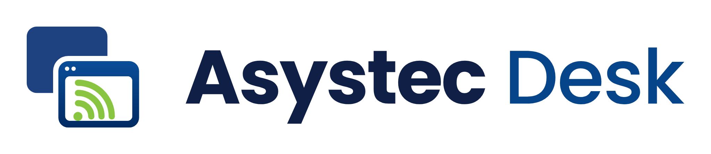

# Asystec Desk

<picture>
  <source media="(prefers-color-scheme: dark)" srcset="desktop/assets/logo_dark.png">
  
</picture>

Cliente de soporte remoto para Windows x64, basado en RustDesk OSS y configurado
para los servidores de Asystec. Licencia AGPL-3.0.

- [Descargar la última versión de Asystec Desk para Windows](https://github.com/asystec-io/asystec-desk/releases/latest/download/Asystec-Desk-Setup.exe)
- [Código completo del cliente](app/)
- [Cambios y validación de la versión 0.1.3](desktop/RELEASE-0.1.3.md)
- [Compilación y herramientas](desktop/README.md)

La versión 0.1.3 simplifica el instalador: bienvenida con aviso al continuar
y licencia consultable, sin marcar «Acepto». Incluye la identidad final
«Dos ventanas» y la ventana para copiar ID y contraseña. El repositorio y las descargas son públicos. El
instalador todavía no tiene firma digital propia.

El enlace de descarga anterior se mantiene entre versiones. Para publicar una
actualización, adjuntar el instalador con el mismo nombre `Asystec-Desk-Setup.exe`
a la nueva versión y marcarla como Latest después de verificar los archivos.
Las versiones preliminares no sustituyen la descarga más reciente.

Para reconstruir el cliente desde las fuentes incluidas, prepara las herramientas
descritas en `desktop/README.md` y ejecuta desde la raíz:

```powershell
. ./desktop/Enter-BuildEnvironment.ps1
./desktop/Build-Windows.ps1 -SourceDirectory ./app
./desktop/Build-Setup.ps1
```

Los binarios y fuentes empaquetadas se distribuyen como archivos de la versión
de GitHub; `dist/` y las cachés de compilación no se incorporan al historial Git.

## Infraestructura y antecedentes locales

El cliente propio para Windows, basado en RustDesk y con código abierto, se
documenta en [desktop/README.md](desktop/README.md). Incluye preparación de fuentes
fijadas, identidad Asystec, configuración del servidor y herramientas de compilación.
La primera versión del [instalador Asystec Desk](dist/Asystec-Desk-Setup.exe) fue compilada y probada
en Windows Sandbox contra el relay propio de Asystec. Pasaron instalación,
servicio, configuración de red, autenticación y conexión cifrada por TCP.
Consulta el [informe de esta versión](desktop/RELEASE-0.1.0.md).
Esa primera versión utilizaba un icono AD provisional, sustituido en 0.1.2.
El instalador descrito abajo corresponde al trabajo anterior con binarios
oficiales RustDesk y conserva su marca original.

## Servidor RustDesk de Asystec

Configurado el 20 de octubre de 2026 en la instancia Lightsail `asystec-desk`,
región `us-east-1`. RustDesk Server OSS **1.1.16**, Ubuntu 24.04, IP
**184.197.59.221**. Esta edición no requiere licencia de RustDesk; AWS mantiene
los cargos de alojamiento y transferencia que correspondan al plan contratado.

## Paquetes listos para clientes Windows

Los paquetes usan el cliente oficial RustDesk **1.5.0** para Windows 10/11 x64.
No requieren RustDesk Pro.

- [Instalador EXE](dist/Asystec-Soporte-Setup.exe): abrir, aceptar el permiso de
  administrador y seguir el asistente en español. Incluye el MSI y configura
  el servidor, la clave pública, el relay y la contraseña propia del equipo.
  Al finalizar ofrece mostrar las credenciales. No requiere descomprimir archivos.
- [Instalador ZIP alternativo](dist/Asystec-RustDesk-Instalador.zip): extraer el ZIP,
  abrir `INSTALAR-ASYSTEC.cmd`, aceptar la elevación de Windows y esperar `LISTO`.
  Incluye el MSI oficial; lo instala si hace falta y aplica los cuatro ajustes
  de servidor. No rebaja versiones posteriores ya instaladas.
  Genera una contraseña permanente distinta por equipo y muestra ID y contraseña
  al terminar. `VER-CREDENCIALES.cmd` permite consultarlos después con UAC.
- [Portable para soporte puntual](dist/Asystec-RustDesk-Portable.zip): extraer
  y abrir `ABRIR-SOPORTE-ASYSTEC.cmd`. Conserva el nombre largo del ejecutable,
  porque contiene la configuración. Si el equipo ya tiene configurado otro
  servidor RustDesk, utiliza el instalador para aplicar y comprobar los ajustes.
- [Script independiente](clients/windows/Instalar-Asystec.ps1): puede enviarse
  solo; si el MSI no está junto al script, lo descarga del GitHub oficial.

Los paquetes contienen únicamente la dirección y la clave **pública** del servidor.
El instalador genera una contraseña local de 24 caracteres y la reutiliza en
ejecuciones posteriores. Guarda una copia cifrada con DPAPI y acceso exclusivo
de Administradores/SYSTEM en `%ProgramData%\Asystec\RustDesk`. Configura contraseña
permanente o aceptación manual; el portable conserva su comportamiento anterior.
El cliente conserva la marca RustDesk y los binarios originales firmados
por PURSLANE. Cada ZIP incluye licencia y enlaces al código fuente de la versión.

El instalador verifica SHA-256, firma Authenticode y lectura posterior de servidor
ID, relay, clave y API. Guarda en TEMP un registro y los ajustes anteriores.
Detener sesiones de soporte antes de ejecutarlo: instalar o cambiar el servidor
puede interrumpirlas. No reinicia Windows automáticamente.

### Validación y reconstrucción

Las pruebas guardadas en [verification.json](dist/verification.json) verifican:
firmas y hashes de los archivos extraídos del ZIP, rechazo de un paquete alterado,
codificación de configuración, rechazo de ajustes incorrectos, argumentos con
espacios y comillas, captura de salida del cliente oficial y ejecución
`-ValidateOnly` del instalador empaquetado en Windows PowerShell 5.1.
También verifican cifrado DPAPI, persistencia de la contraseña, rechazo de
credenciales corruptas o de otro equipo, definición de ACL y aceptación/rechazo
del comando de contraseña mediante un ejecutable de prueba.

El EXE se probó mediante instalación real en Windows 11 Enterprise limpio dentro
de Windows Sandbox: pasaron las 13 comprobaciones de instalación, servicio,
configuración, cifrado y permisos, repetición, fallo y recuperación. También se
confirmó el acceso al escritorio con la contraseña generada mediante conexión
retransmitida y cifrada por TCP, y se revisó la ventana de credenciales.
El reinicio completo de Windows conservó los datos y el servicio volvió a
iniciar automáticamente; después se autenticó y controló el escritorio remoto.
Consulta [el informe del EXE](dist/exe-test-report.md) y
[las pruebas de la versión final en Windows limpio](dist/final-exe-test/verification.json).

```powershell
powershell.exe -NoProfile -ExecutionPolicy Bypass -File .\clients\Build-Packages.ps1
powershell.exe -NoProfile -ExecutionPolicy Bypass -File .\clients\Test-Packages.ps1
powershell.exe -NoProfile -ExecutionPolicy Bypass -File .\clients\Build-Exe.ps1
```

El EXE de Asystec aún no tiene firma Authenticode propia; los binarios oficiales
de RustDesk incluidos conservan su firma PURSLANE. El manifiesto del ejecutable
está en [exe-manifest.json](dist/exe-manifest.json). La reconstrucción y las
pruebas están documentadas en [clients/README.md](clients/README.md).

El contenido de `dist/` está excluido de Git por su tamaño. El EXE probado 1.5.0.3
se publicó el 20 de octubre de 2026 como [descarga directa](https://asystec-apps.s3.us-east-2.amazonaws.com/updates/herramientas/Asystec-Soporte-Setup.exe).
La descarga pública se verificó completa contra el SHA-256 del artefacto probado.
Los ZIP alternativos se conservan localmente.
Referencia: [despliegue oficial de clientes](https://rustdesk.com/docs/en/self-host/client-deployment/).

## Conectar los equipos

En **cada equipo**, abre RustDesk → **Configuración → Red → Servidor ID/Relay**.
Si aparece, desbloquea la configuración de red y guarda estos valores:

| Campo | Valor |
|---|---|
| Servidor ID | `184.197.59.221` |
| Servidor Relay | `184.197.59.221:21117` |
| Clave / Key | `6o6MWnTv2Vh6l+1oCrfEnlUSNQmMXaaLpqctaNcCulg=` |
| Servidor API | Dejar vacío |

La clave anterior es la **clave pública del servidor**, no una contraseña de
acceso remoto. No se necesita iniciar sesión en una cuenta Pro. Para conectarse,
ambos equipos deben usar esta configuración; luego introduce el ID del otro
equipo y utiliza su contraseña o solicita la aceptación de la persona.

Los clientes de los equipos no se modificaron durante esta instalación.

Descarga oficial: <https://rustdesk.com/download>

## Estado verificado

- `rustdesk-hbbs` y `rustdesk-hbbr` activos, con inicio automático y reinicio
  automático en caso de fallo; se comprobó también un reinicio de ambos servicios.
- Reglas nuevas en Lightsail: TCP `21115–21117` y UDP `21116`, para IPv4.
- Firewall UFW activo: permite SSH y los puertos nativos de RustDesk.
- Puertos web `21118/21119` sin acceso público; API Pro no instalada.
- Procesos ejecutados como usuario de sistema `rustdesk`, sin privilegios root.
- Clave privada del servidor con permisos `0600`; permanece en el servidor.
- Descarga oficial verificada contra SHA-256 de GitHub Releases.
- Pruebas externas satisfactorias: TCP, respuesta de prueba NAT, respuesta UDP,
  transferencia real en ambos sentidos por relay y rechazo del relay sin clave.

Las pruebas iniciales fueron de protocolo y retransmisión. Durante la validación
del EXE también se autenticó y visualizó el escritorio del Windows Sandbox
mediante el relay de Asystec.

Evidencias: [resultado con la nueva IP](server/verification-2026-10-20-static-ip.json),
[resultado inicial](server/verification-2026-10-20.json) y
capturas del firewall de Lightsail conservadas localmente.

## Dirección IP

El 20 de octubre de 2026 se cambió la dirección inicial `3.87.110.232` por
la IP estática `184.197.59.221`, vinculada en Lightsail como `asystec-desk_ip`.
Se verificó la vinculación en la consola de AWS. Se actualizó el relay anunciado en
`/etc/systemd/system/rustdesk-hbbs.service` y se reinició `rustdesk-hbbs`.
La clave pública sigue siendo la misma. Los clientes deben usar la nueva IP en
los campos servidor ID y relay.

Copia de la unidad anterior al cambio:
`/var/backups/rustdesk/rustdesk-hbbs-before-ip-184.197.59.221.service`.

## Administración

Acceso SSH desde PowerShell:

```powershell
ssh -i "C:\Users\bryan\Downloads\LightsailDefaultKey-us-east-1.pem" ubuntu@184.197.59.221
```

Comandos en el servidor:

```bash
sudo systemctl status rustdesk-hbbs rustdesk-hbbr --no-pager
sudo journalctl -u rustdesk-hbbs -u rustdesk-hbbr -n 100 --no-pager
sudo systemctl restart rustdesk-hbbs rustdesk-hbbr
sudo ufw status verbose
```

Binarios: `/opt/rustdesk/releases/1.1.16/`. Datos y claves:
`/var/lib/rustdesk/`. Comprobante de versión y hashes:
`/opt/rustdesk/install-receipt.txt`.

Respaldo inicial privado de claves y servicios:
`/var/backups/rustdesk/initial-keys-and-units-20261020.tar.gz`.
Es una copia en la misma instancia, no una copia externa de recuperación.
Para migraciones, conserva las claves y la base de datos; no regeneres la clave
si quieres que los clientes sigan validando el servidor.

El [instalador guardado](server/install-rustdesk.sh) fija la versión y su checksum.
Está destinado a Ubuntu amd64 y configura UFW; revisa la IP y las reglas si se
reutiliza en otra máquina. No configura el firewall de AWS.

Prueba externa repetible desde este equipo:

```powershell
python .\server\verify-rustdesk.py
```

## Desactivar o revertir esta instalación

Para detener RustDesk preservando datos y claves:

```bash
sudo systemctl disable --now rustdesk-hbbr rustdesk-hbbs
sudo ufw delete allow 21115:21117/tcp
sudo ufw delete allow 21116/udp
```

En Lightsail → instancia `asystec-desk` → Redes, elimina únicamente las dos
reglas de RustDesk indicadas arriba. Conserva la regla SSH. UFW queda activo
protegiendo el servidor y las claves permanecen disponibles para recuperación.

Referencias oficiales:
[instalación](https://rustdesk.com/docs/en/self-host/rustdesk-server-oss/install/),
[configuración de clientes](https://rustdesk.com/docs/en/self-host/client-configuration/),
[versión 1.1.16](https://github.com/rustdesk/rustdesk-server/releases/tag/1.1.16).
